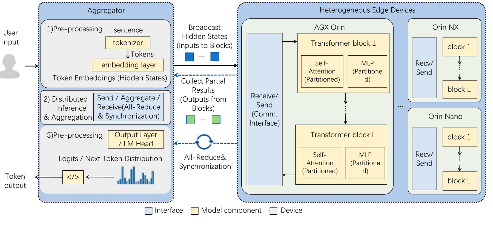
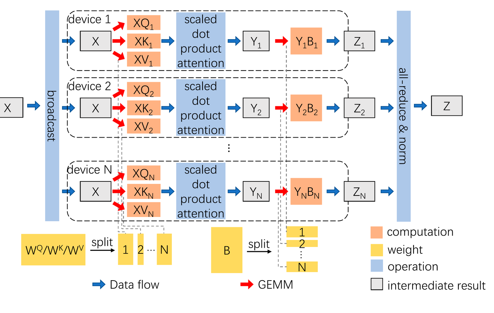
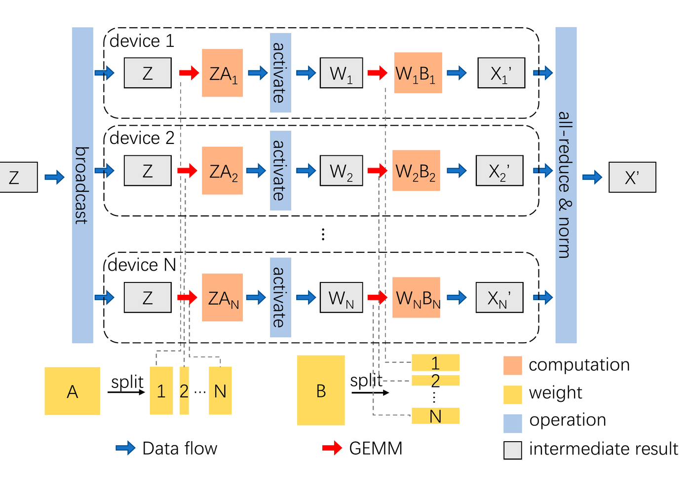
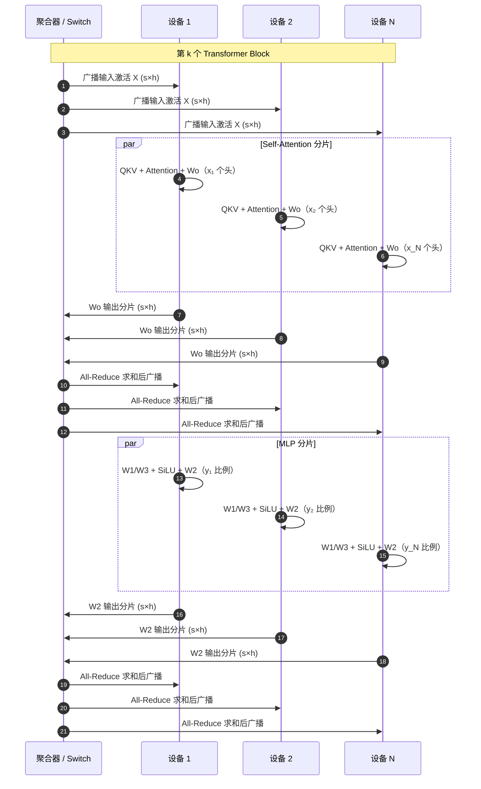
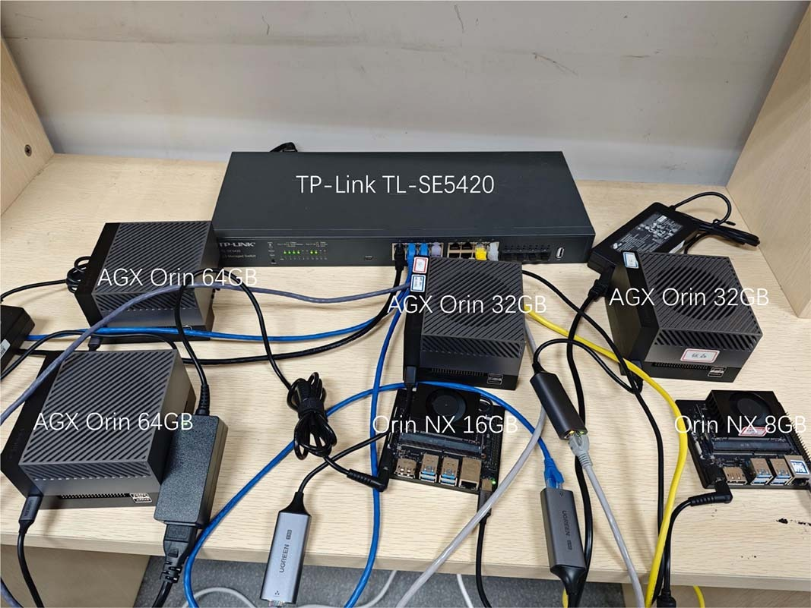
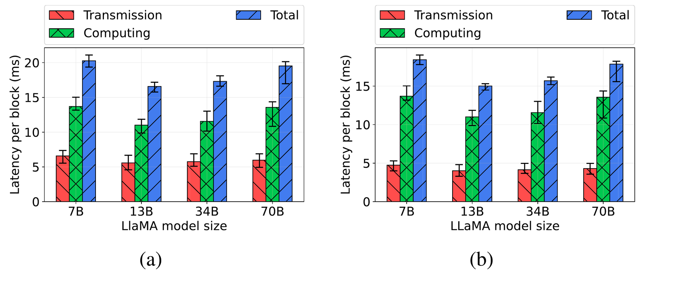
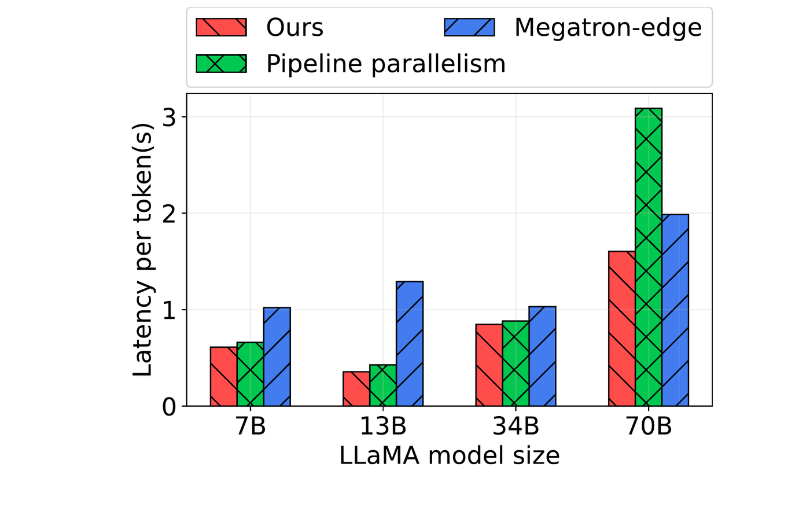
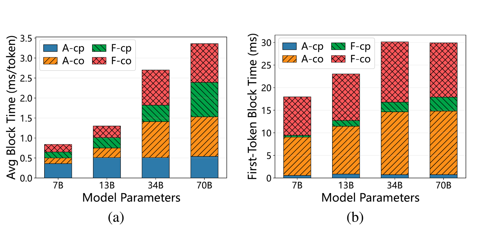
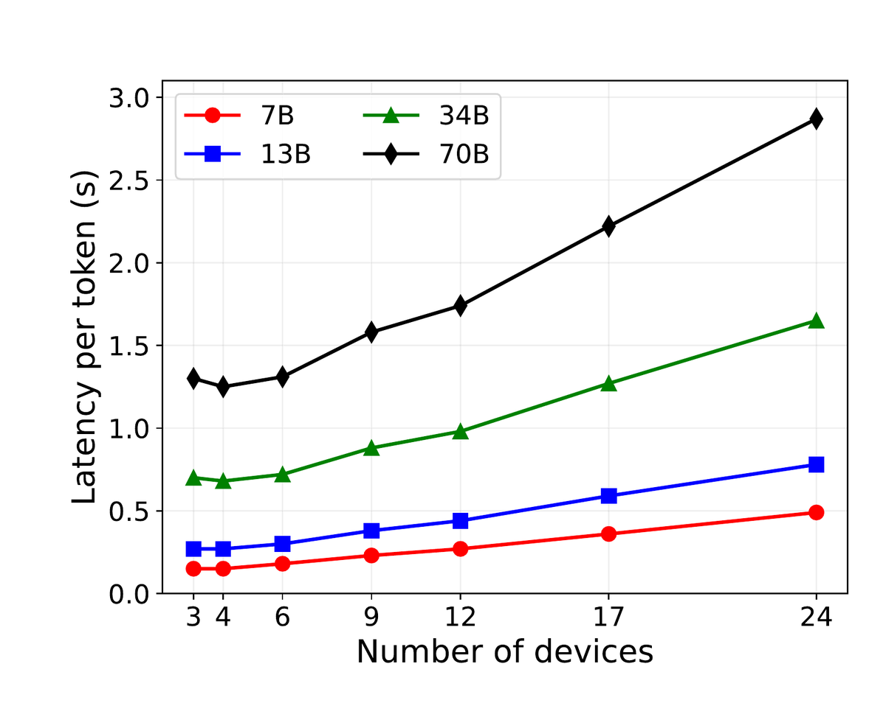

# Split-LLM

**Enabling Distributed Cooperative Full-Size LLM Inference With Tensor Parallelism Across Heterogeneous Edge Devices**

[核心思想](#核心思想) · [系统流程](#系统流程) · [项目结构](#项目结构) · [快速开始](#快速开始) · [通信协议](#通信协议) · [代码详解](#代码详解) · [实验数据](#实验数据) · [注意事项](#注意事项)

> 本仓库是论文 **"Enabling Distributed Cooperative Full-Size LLM Inference With Tensor Parallelism Across Heterogeneous Edge Devices"**（IEEE Transactions on Computers, Vol. 75, No. 12, Dec. 2026）的研究原型代码。它把 LLaMA 等全尺寸 LLM 的注意力头和 MLP 中间维度切分到多台异构边缘设备（NVIDIA Jetson）上，通过中心交换机做 All-Reduce，实现协同推理；同时包含分区算法的数值模拟、真实设备的 socket 推理脚本，以及通信延迟的测量数据。



*图 1：系统总览。聚合器负责 Token Embedding、LM Head 和 All-Reduce 同步；每台设备只保存并计算自己那份 Self-Attention / MLP 分片。（截取自论文 Fig. 1）*

> README 中的插图均截取自论文（矢量图按 900 dpi 渲染；图 4 的现场照片是论文内嵌位图，约 320 dpi）。如果之后拿到作者提供的高清原图，尤其是图 4 的实验环境照片，直接覆盖 `docs/figures/` 下的同名文件即可，无需修改 README。

---

## 摘要

大模型推理正在从云端走向边缘，但单台边缘设备的算力与显存都不足以承载全尺寸 LLM。本工作利用**张量并行（Tensor Parallelism）**，把每个 Transformer Block 拆成两部分并分配到多台异构设备：

- **Self-Attention**：按注意力头（head）切分，设备 $i$ 负责 $x_i$ 比例的头；
- **MLP / FFN**：按中间层维度切分，设备 $i$ 负责 $y_i$ 比例的中间维度。

每个设备只保存自己那一份权重，但保留完整的模型结构。注意力输出（$W_O$ 之后）和 MLP 输出（$W_2$ 之后）各需要一次 All-Reduce：设备把局部分片发给聚合器（Aggregator / Switch），聚合器求和后把完整的 $h$ 维激活广播回所有设备。因此每个 Transformer Block 有 **2 次同步**，$l$ 层共 $2l$ 次。

分区比例 $x_i, y_i$ 由如下目标决定：在**显存约束**下，最小化所有设备中最大的计算时间，使各设备尽量同时算完（负载均衡）。论文将其建模为凸整数优化问题，先松弛为连续问题并用**贪心注水算法**求解，再用**整数取整算法**得到每个设备实际分到的头数和 MLP 维度，并给出近似比保证。真实实验在 7 台 Jetson（2×AGX Orin 64GB、2×AGX Orin 32GB、1×Orin NX 16GB、2×Orin Nano 8GB）上部署 LLaMA-7B/13B/34B/70B，最低达到约 **0.65 秒/token**。

本仓库对应论文中的算法实现与系统原型，包含：

- 分区算法的 Python 实现（`my_split_xy.py`、`const.py`、`jetson.py`）；
- 与 Pipeline Parallelism、Megatron-LM 式 Tensor Parallelism 的端到端时延对比脚本（`calculate.py`）；
- 基于 socket 的分布式推理客户端（`modify_model_socket*.py`）；
- TCP/UDP 聚合服务器（`serverdick.py`、`test_server.py`、`udp_server*.py`、`tcp_udp_server.py`）；
- 真实设备上测得的同步耗时数据（`npy/*.npy`）。

---

## 核心思想

### 1. 细粒度张量并行

对 LLaMA 的每个 Transformer Block，权重按如下方式切分：

| 模块 | 切分方式 | 设备本地计算 | 是否需要通信 |
| --- | --- | --- | --- |
| Q / K / V | 按输出维度（列）切分 | 只计算本地 $x_i$ 比例的头 | 否 |
| Attention | 本地 softmax、加权求和 | 本地头独立计算 | 否 |
| $W_O$ | 按输入维度（行）切分 | 本地部分和 | **All-Reduce** |
| $W_1, W_3$ | 按输出维度（列）切分 | 本地中间维度分片 | 否 |
| SiLU / 逐元素乘 | 本地逐元素 | 无需同步 | 否 |
| $W_2$ | 按输入维度（行）切分 | 本地部分和 | **All-Reduce** |

由于非线性激活（SiLU）夹在两个线性层之间，每个设备必须在本地完成自己那份中间维度的激活，不能把激活拆开；这正是选择“列切分 → 本地激活 → 行切分”的原因。



*图 2：每台设备分到不同数量的注意力头，本地完成 QKV、缩放点积注意力和 $W_O$，再对 $Z_i$ 做 All-Reduce；$W^Q/W^K/W^V$ 按输出维度切分，$B$（即 $W_O$）按输入维度切分。（截取自论文 Fig. 2）*



*图 3：每台设备分到不同数量的 MLP 列/行，本地完成 $W_1/W_3$、激活和 $W_2$，再对 $X_i'$ 做 All-Reduce；权重矩阵 $A$、$B$ 分别按列/行切分。（截取自论文 Fig. 3）*

### 2. 关键符号

| 符号 | 代码中的名字 | 含义 |
| --- | --- | --- |
| $a$ | `a_header` / `a` | 注意力头总数 |
| $h$ | `h_dim` / `h` | 隐藏层维度 |
| $h_{out}$ | `h_out` | MLP 中间维度 |
| $l$ | `l` / `l_blockn` | Transformer Block 层数 |
| $s$ | `s_squence` / `s` | 输入序列长度（prefill） |
| $s_{kv}$ | `s_kv` | KV Cache 长度 |
| $x_i$ | `device.x` | 设备 $i$ 分到的注意力头比例，$\sum_i x_i = 1$ |
| $y_i$ | `device.y` | 设备 $i$ 分到的 MLP 中间维度比例，$\sum_i y_i = 1$ |
| $C_i$ | `computing` | 设备 $i$ 的算力（FLOPS） |
| $M_i$ | `memory` | 设备 $i$ 的显存（Byte） |
| $\beta$ | `beta` | 运行时显存 / 参数显存的折算系数 |
| $\dagger_i$ | `dagger` | $C_i / \sum_j C_j$，设备算力占比 |
| $x_i^-$ / $y_i^-$ | `x_` / `y_` | 取整后的头数 / MLP 维度单位数 |

### 3. 计算量与目标函数

单个 Block 中，设备 $i$ 的计算时间为：

$$
T_i^{att}(x_i) = \frac{A x_i}{C_i}, \qquad
T_i^{mlp}(y_i) = \frac{M y_i}{C_i}
$$

其中（对应 `my_split_xy.py`）：

$$
A = 8 s h^2 + 4 s s_{kv} h
$$

$$
M = 4 s h h_{out} + 2 s h_{out}
$$

Attention 阶段和 MLP 阶段分别由最慢的设备决定；代码将两个阶段的最大值相加，作为每个 Block 的计算时间：

$$
T_{comp} = l \cdot \left( \max_i \frac{A x_i}{C_i} + \max_i \frac{M y_i}{C_i} \right)
$$

再加上通信时间 $T_{comm}$（每个 Block 两次同步，共 $2l$ 次），得到端到端时延：

$$
T_{total} = T_{comp} + T_{comm}
$$

优化目标就是最小化 $T_{total}$，等价于在给定 $T_{comm}$ 下最小化两个 $\max$ 项。

### 4. 显存约束

设备 $i$ 的权重参数近似为：

$$
P_i = \underbrace{2.25 h^2}_{\text{attention}} \cdot x_i
    + \underbrace{3 h_{out} h}_{\text{MLP}} \cdot y_i
$$

代码中：

```python
Parax = 2.25 * h * h      # attention 参数量系数
Paray = 3 * h_out * h     # MLP 参数量系数
```

考虑运行时显存放大和每层分摊后，约束为：

$$
Paray \cdot y_i + Parax \cdot x_i \le \frac{M_i}{\beta \cdot 2 \cdot l}
$$

其中 $2$ 表示每个参数按 2 Byte（fp16/bf16）计算，$l$ 表示把整模型显存均摊到每个 Block，$\beta$ 把参数显存折算成运行时显存。对应 `Device.mem_cst()` / `Jetson.mem_cst()`。

### 5. 求解：贪心注水 + 整数取整

论文的 Algorithm 1 分为两步，`my_split_xy.py` 中完整实现：

**（1）连续松弛：贪心注水**

- 按 `computing / memory` 从大到小排序，显存最紧张的设备优先分配；
- 初始按算力占比分配：$x_i = \dagger_i$；
- 如果某个设备的显存约束被违反，就把它的 $x_i$ 截断到显存允许的最大值，并从“待分配总量”中扣除；
- 对 $y_i$ 重复同样的过程（此时还要扣除已经分配给 $x_i$ 的显存）。

**（2）整数取整**

- 头数必须是整数：$x_i^- = \lfloor x_i \cdot a \rfloor$，然后把剩余的头逐个分配给 $\arg\min_i (x_i^- + 1)/C_i$ 的设备，每次分配后检查显存约束；
- MLP 维度同理：$y_i^- = \lfloor y_i \cdot h_{out} \rfloor$，再按 $(y_i^- + 1)/C_i$ 最小者补齐到 $h_{out}$。

这种“每次把下一个单位给边际耗时最小的设备”的策略，就是在离散条件下逼近 $\max_i T_i$ 最小的注水解。

### 6. 通信时间建模

`jetson.py` 使用从真实设备测得的经验模型（单位：秒）：

```python
sendrecv_time_mean = 5.96 / 1000 / 2          # 每次同步的均值
sendrecv_time_std  = 5.96 / 1000 / 15 / 2     # 每次同步的标准差

mean = sendrecv_time_mean * (h / 8192) * (N + 1) / 6
sumtime = sum(np.random.normal(loc=mean, scale=sendrecv_time_std, size=2 * l))
```

含义是：单次同步延迟与隐藏维度 $h$ 近似成正比，并随设备数 $N$ 线性增长；每个 Block 同步两次，$l$ 层共采样 $2l$ 次并求和。`npy/*.npy` 保存的就是真实测得的每次同步耗时。

---

## 系统流程

每个 Transformer Block 的执行流程如下（所有设备并行）：



聚合器还负责 Token Embedding 和最后的 LM Head（代码中以注释标出），设备端只保留 Transformer Block。论文的真实实验中，聚合器由其中一台 Jetson 担任，所有设备通过一台工业交换机（TP-Link TL-SE5420）互联。

---

## 项目结构

~~~text
split_llm/
├── const.py                      # 常量、设备类、显存约束（LLaMA-70B 示例）
├── my_split_xy.py                # 核心：贪心注水 + 整数取整的分区算法
├── jetson.py                     # 数值模拟入口：多种 Jetson 配置 × LLaMA/Gemma 参数
├── calculate.py                  # 与 Pipeline / Tensor Parallelism 的时延对比统计
│
├── modify_model_socket.py        # 分布式推理客户端 v1：长连接 TCP，CPU/float32 原型
├── modify_model_socket_3.py      # 分布式推理客户端 v2：每次同步新建 TCP，含细粒度计时
├── modify_model_socket_5.py      # 分布式推理客户端 v3：UDP 分片 + 序号，含细粒度计时
│
├── serverdick.py                 # TCP 聚合服务器（pickle 序列化，localhost 调试版）
├── test_server.py                # TCP echo 服务器（单设备收发测试）
├── udp_server.py                 # UDP 聚合服务器：按序号重组、求和、广播
├── udp_server2.py                # UDP 聚合服务器早期版本（无序号重组）
├── tcp_udp_server.py             # TCP 收 + UDP 广播的混合聚合服务器
│
├── npy/
│   ├── 7Bsendrecivetime.npy      # LLaMA-7B  每次同步耗时（秒）
│   ├── 13Bsendrecivetime.npy     # LLaMA-13B 每次同步耗时（秒）
│   ├── 34Bsendrecivetime.npy     # LLaMA-34B 每次同步耗时（秒）
│   └── 70Bsendrecivetime.npy     # LLaMA-70B 每次同步耗时（秒）
│
├── docs/figures/                 # README 引用的论文插图（可替换为高清版）
│   ├── fig1-system-overview.png
│   ├── fig2-attention-partition.png
│   ├── fig3-mlp-partition.png
│   ├── fig4-testbed.jpg
│   ├── fig5-real-latency.png
│   ├── fig6-parallel-comparison.png
│   ├── fig8-simulation-block.png
│   └── fig10-device-scaling.png
│
└── README.md
~~~

| 文件 | 作用 | 运行位置 |
| --- | --- | --- |
| `const.py` | 定义模型/设备常量、`Device` 类、`mem_cst` 显存约束 | 被其他脚本 import |
| `my_split_xy.py` | 给定设备列表，计算最优的 $x_i, y_i$ 并评估总时延 | 被 `jetson.py` import |
| `jetson.py` | 批量模拟不同设备组合，结果追加到 `out.txt` | 单机 |
| `calculate.py` | 读取硬编码的实验数据，计算相对加速比 | 单机 |
| `modify_model_socket*.py` | 每台设备上的推理客户端 | 每台 Jetson |
| `udp_server.py` / `tcp_udp_server.py` / `serverdick.py` | 聚合器/交换机上的 All-Reduce 服务 | 聚合器 |
| `test_server.py` | 最小 TCP echo 服务，用于测带宽/延迟 | 聚合器或单机 |
| `docs/figures/` | README 中引用的论文插图，可直接用高清原图覆盖 | — |

---

## 环境依赖

仓库没有提供 `requirements.txt` 或 `environment.yml`，按下述依赖手动安装即可。

- **Python** 3.8+
- **NumPy**：模拟与数组序列化
- **PyTorch**：分布式推理客户端
  - `modify_model_socket_3.py` / `_5.py` 使用 `torch.cuda` 和 `bfloat16`，需要 CUDA 版 PyTorch；
  - `modify_model_socket.py` 可在 CPU 上跑通。
- **操作系统**：Linux（Jetson 上为 JetPack / L4T）
- **硬件**：多台 NVIDIA Jetson（论文使用 AGX Orin 64GB/32GB、Orin NX 16GB、Orin Nano 8GB）+ 一台交换机
- **模型权重**：每台设备一份切分后的 `device{id}.pth`（仓库**不包含**权重切分脚本和权重文件）

安装示例：

```bash
python -m pip install numpy torch
# Jetson 上请按 JetPack 版本安装对应的 CUDA 版 PyTorch
```

---

## 快速开始

### 1. 数值模拟：验证分区算法

`jetson.py` 是模拟入口。它使用 Gemma-2-27B 的模型参数和 7 组 Jetson 设备组合，逐组调用 `my_split_xy.running()`，把每组的总时延追加写入 `out.txt`。

```bash
python jetson.py
```

输出示例（节选）：

```text
h=4608, h_out=36864

running total dev No.=3
xy
Optimal value: ...
Total computation time: ...
Total commuication time: ...
cpt+com time: ...
```

关键配置在 `jetson.py` 顶部：

```python
s_in = 200      # prompt 长度
s = 1           # 输入长度（decode 单 token）
s_kv = s_in     # KV cache 长度

h = 4608        # Gemma-2-27B 隐藏维度
a = 32          # 注意力头数
l = 46          # 层数
beta = 1.14514  # 显存折算系数
h_out = 36864   # MLP 中间维度
```

设备组合在 `deviceMems` 中，每个子列表是一组实验，元素为每台设备的显存（GB）：

```python
deviceMems = [
    [64, 64, 64],
    [64, 64, 32, 32],
    [64, 32, 32, 32, 16, 16],
    [64, 32, 16, 16, 16, 16, 16, 8, 8],
    [16] * 12,
    [32, 16, 16, 16, 16, 8, 8, 8, 8, 8, 8, 8, 8, 8, 8, 8, 8],
    [8] * 24,
]
```

显存到算力的映射由 `MEMTOCOMP` 给出（论文按 NVIDIA 官方规格）：

```python
MEMTOCOMP = {64: 275, 32: 200, 16: 100, 8: 40}  # GB -> TOPS
# 实际 FLOPS = TOPS * 1e12 / 680 / 10
```

> 想换成自己的模型/设备，只需要修改 `h/a/l/h_out/s/s_kv/beta` 和 `deviceMems`，然后重跑 `python jetson.py`。

### 2. 结果统计：与 Pipeline / Tensor Parallelism 对比

`calculate.py` 中硬编码了 7B/13B/34B/70B/Qwen/Phi-4/Gemma 在 7 种设备组合下的时延，每一行依次是：

```python
data70B = [
    [...],  # ours：本方法
    [...],  # pipeline：流水线并行
    [...],  # tensor parallelism：Megatron-LM 式张量并行
]
```

选择对比基线后运行：

```bash
python calculate.py
```

```python
ours = 0
pipeline = 1
megatronedge = 2

vs = pipeline   # 改成 megatronedge 可与张量并行对比
```

脚本会逐配置打印 `(baseline - ours) / baseline`，最后打印平均值。正值表示本方法更快：

```text
0.57
0.64
...
avg: 0.58
```

默认只统计 `[data7B, data13B, data34B, data70B]`；`qwen/phi4/gemma` 的数据已经准备好，取消注释即可参与统计。

### 3. 真机实验：分布式推理

> 这一部分需要多台设备、预先切分好的权重，以及可被设备访问的聚合器 IP。仓库中的脚本是**实验原型**，IP、端口、模型参数、checkpoint 路径都写死在代码里，运行前需要逐项修改。



*图 4：真实实验环境。7 台 NVIDIA Jetson（2×AGX Orin 64GB、2×AGX Orin 32GB、1×Orin NX 16GB、2×Orin Nano 8GB）通过 TP-Link TL-SE5420 交换机互联，其中一台 Orin Nano 担任聚合器。（截取自论文 Fig. 4）*

#### 步骤 1：准备每台设备的权重分片

根据分区算法得到每台设备的头数 `x_ * a` 和 MLP 维度 `y_ * h_out`，然后：

1. 从完整 LLaMA 权重中切出该设备的 `wq/wk/wv/wo` 和 `w1/w2/w3`；
2. 保存为 `device{id}.pth`，其 `state_dict` 需要与 `Transformer` 的层结构一致；
3. 将文件放到每台设备的工作目录。

`modify_model_socket_3.py` / `_5.py` 末尾默认加载：

```python
model.load_state_dict(torch.load('device6.pth'))
```

请改成该设备实际的分片文件。

#### 步骤 2：启动聚合器

任选一种服务器脚本，在聚合器（或任意一台能同网段访问的机器）上运行。

UDP 版本（推荐用于低延迟实验）：

```bash
python udp_server.py
```

TCP echo 版本（单设备带宽/延迟测试）：

```bash
python test_server.py
```

TCP 聚合版本（pickle，两个设备调试）：

```bash
python serverdick.py
```

#### 步骤 3：配置设备端

以 `modify_model_socket_5.py` 为例，需要修改：

```python
# 1) 聚合器 IP 和端口
s.sendto(sequence_number + packet, ('172.31.69.240', 12345))
s.bind(('0.0.0.0', 12346))

# 2) 模型分片参数：必须与分区结果一致
args = ModelArgs(
    dim=8192,
    n_layers=20,
    n_heads=64,
    n_kv_heads=8,
    n_local_heads=19,   # 该设备分到的头数 = x_i * n_heads
    hidden_dim=8181,    # 该设备分到的 MLP 维度 = y_i * h_out
    max_seq_len=100,
)
```

同时在每台设备上把 `n_local_heads`、`hidden_dim`、`device{id}.pth` 改成自己的值。`n_local_kv_heads = n_local_heads`，代码通过

```python
self.n_rep = self.n_local_heads * 8 // self.n_local_kv_heads  # = 8
self.head_dim = args.dim // args.n_heads // 8
```

把每个本地 KV head 复制 8 次，保证 Q 的头数与 K/V 对齐（8 是代码中固定的 head 分组粒度）。

#### 步骤 4：在所有设备上同时启动

```bash
# 每台 Jetson 上分别执行
python modify_model_socket_5.py
```

一次完整前向结束后，每台设备会打印：

```text
one block time:  ...
  ...
result pre-deal time: ...
send time: ...
receive time: ...
de-serialized time: ...
```

`modify_model_socket_3.py` 还会额外打印 TCP `connect`、`send`、`receive` 的分段耗时。

#### 版本差异

| 文件 | 传输方式 | 数据精度 | 适用场景 |
| --- | --- | --- | --- |
| `modify_model_socket.py` | 长连接 TCP，整个前向共用一个 socket | float32 / CPU | 早期原型、协议联调 |
| `modify_model_socket_3.py` | 每次同步新建 TCP 连接 | 发送 float16，计算 bfloat16 | 测量 TCP 建连 + 传输开销 |
| `modify_model_socket_5.py` | UDP 分片 + 4 字节序号 | 发送 float16，计算 bfloat16 | 低延迟、可接受丢包的局域网实验 |

`_3` 和 `_5` 为了缩短实验时间，默认只实例化 `n_layers=20`、`max_seq_len=100`，做一次 100 token 的 prefill；真实部署时请改成完整层数和序列长度。

> v1（`modify_model_socket.py`）中 `n_local_kv_heads = n_local_heads`，且 `n_rep = n_local_heads // n_local_kv_heads = 1`，与 `_3/_5` 的 `n_rep = 8` 不同；它的 Q 头数是 `n_local_heads * 8`。因此 v1 主要用于验证“长连接”协议和 CPU 上的数据通路，精确的 Q/K/V 头对齐请以 `_3/_5` 为准。

---

## 通信协议

### TCP（`test_server.py`、`serverdick.py`、`modify_model_socket_3.py`）

- 服务器监听固定端口，接收数据直到对端**关闭写方向**（EOF），因此客户端必须调用：

  ```python
  s.sendall(data)
  s.shutdown(socket.SHUT_WR)   # 告诉服务器“本次消息结束”
  ```

  缺少这一步，服务器会一直阻塞在 `recv()`。
- `test_server.py` 直接把收到的数据原样发回（echo），用于测量单次 100×8192 float16 张量的收发时间；
- `serverdick.py` 使用 `pickle` 序列化 `torch.Tensor`，把收到的张量聚合并回传。当前代码把聚合条件写成 `len(tensors) == 1`（即单设备直通，双设备求和被注释掉），用于调试；多设备时需改成 `len(tensors) == device_num` 并恢复 `tensors[0] + tensors[1] + ...`。
- `pickle` 只能用于可信局域网，**不要**在公网接收不可信数据。

### UDP（`udp_server.py`、`udp_server2.py`、`modify_model_socket_5.py`）

- 每个数据报 = 4 Byte 大端序号 + 最多 65503 Byte 的 payload；
- 发送端把张量 `tobytes()` 后按 65503 Byte 分片，依次 `sendto(server_ip, 12345)`；
- 服务器按来源地址维护缓冲区，按序号把分片写回 `sequence_number * buffer_size` 的位置；
- 收齐 `num_packets` 个分片后，把各设备的张量逐元素求和；
- 通过 `255.255.255.255:12346` 广播完整张量（或按 `udp_server2.py` 的方式逐客户端单播）；
- 客户端在本地 `12346` 端口接收，拼回完整张量。

UDP 版本没有 ACK、重传和乱序纠正，客户端假设分片按顺序到达：

```python
while received_packets < num_packets:
    packet, _ = s.recvfrom(65536)
    start = received_packets * buffer_size
    received_data[start:start + len(packet)] = packet
    received_packets += 1
```

因此它只适合**同一局域网、低丢包**的实验环境。论文正文的真实实验使用 KCP 来获得可靠且低延迟的传输；本仓库提供的是更底层的 TCP/UDP socket 原型，便于替换成 KCP、RDMA 等传输层。

### 混合方案（`tcp_udp_server.py`）

- 每台设备通过 TCP 连接到 `12345 + device_id` 端口，服务器把数据收齐；
- 服务器求和后，通过 UDP 广播 `255.255.255.255:12346`；
- 适合“上行可靠、下行广播”的场景。

### 张量尺寸约定

服务器脚本中硬编码了：

```python
s, h = 100, 8192          # 100 个 token，隐藏维度 8192
total_size = 2 * s * h    # float16：每个元素 2 Byte
```

这对应 LLaMA-70B（$h=8192$）的一次 100-token prefill。如果换成其他模型或序列长度，**必须**同步修改服务器和客户端中的 `s`、`h`、`dtype` 和 `total_size`，否则会出现长度不匹配。

---

## 代码详解

### `const.py`

定义 LLaMA-70B 的模型常量、两台异构设备的参数，以及 `Device` 类。

```python
s = 100
beta = 0.85

# LLaMA-70B
a = 32
h = 4096
l = 32
alpha = 4
h_out = 11008

raw_device_Mem = [5, 10]                 # GB
deviceComputingPower = [40, 100]         # TFLOPS
deviceMem = [i - 1.5 for i in raw_device_Mem]  # 预留 1.5GB 给系统
```

- `M = 4*s*h*h_out + 2*s*h_out`：MLP 计算量；
- `A = 8*s*h*h + 4*s*s*h`：Attention 计算量；
- `Paray = 3*h_out*h`：MLP 参数量；
- `Parax = 2.25*h*h`：Attention 参数量；
- `Device.dagger = C / sum(C)`：算力占比；
- `Device.mem_cst()`：显存约束；
- `devices`：根据设备列表生成的 `Device` 对象。

这个文件是一个**最小示例**，没有 `main()`；`jetson.py` 使用的是功能相同但字段更全的 `Jetson` 类。可以把它当作“如何接入自己的设备参数”的模板。

### `my_split_xy.py`

核心分区算法，函数签名为：

```python
running(jetsons, a_header, beta, l_blockn, h_dim, h_out,
        s_squence, Parax, Paray, sumtime)
```

执行流程：

1. **计算计算量**：

   ```python
   M = 4 * s_squence * h_dim * h_out + 2 * s_squence * h_out
   s_kv = 200
   A = 8 * s_squence * h_dim * h_dim + 4 * s_squence * s_kv * h_dim
   ```

   `s_kv` 在这里固定为 200，对应约 200 token 的 KV Cache。

2. **按 `computing / memory` 降序排序**：显存最紧的设备先分，避免后面“分得太多装不下”。

3. **分配 $x$（Attention 头）**：

   ```python
   jetsons[i].x = jetsons[i].dagger * a / b
   if not jetsons[i].mem_cst():
       b -= jetsons[i].dagger
       x_ = (jetsons[i].memory / beta / 2 / l_blockn - h_dim) / Parax
       a -= x_
       jetsons[i].x = x_
       jetsons[i].isFull = True
   ```

   其中 `a`、`b` 分别是“剩余待分配比例”和“剩余设备算力占比之和”。

4. **整数取整 $x$**：先 `x_ = int(x * a_header)`，再逐个头分配给边际耗时 `(x_ + 1) / computing` 最小的设备，并在每次分配后检查显存。

5. **分配 $y$（MLP 维度）**：与 $x$ 相同，但显存上限要减去 Attention 已经占用的部分：

   ```python
   y_ = (memory / beta / 2 / l_blockn - h_dim - Parax * x - h_dim) / Paray
   ```

6. **整数取整 $y$**：以 `h_out` 为单位，逐个补齐到 `h_out`。

7. **评估**：

   ```python
   va = max(A * device.x / device.computing)
   vm = max(M * device.y / device.computing)
   total = (va + vm) * l_blockn + sumtime
   ```

   并把 `total` 追加到 `out.txt`（保留两位小数）。

> 注意：算法假设“总显存足够装下整个模型”。如果不可行，取整阶段的 `min()` 可能因为候选设备集合为空而报错，建议先检查设备总显存和 $\beta$ 设置。

### `jetson.py`

数值模拟的驱动脚本：

- 采用 Gemma-2-27B 参数：`h=4608, a=32, l=46, h_out=36864, beta=1.14514`；
- `s=1` 表示 decode 单个 token，`s_in=200`、`s_kv=200` 表示 200 token 的 KV Cache；
- 从 `deviceMems` 中逐组创建 `Jetson` 对象；
- 根据 `MEMTOCOMP` 把显存映射为算力，并除以 `680 * 10` 做实测标定；
- 为每次同步采样正态分布延迟，累加得到 `sumtime`；
- 调用 `running()` 完成分区与评估；
- 以 `[ ... ],` 的形式把每组结果追加到 `out.txt`，便于后续复制到 `calculate.py`。

### `calculate.py`

对比脚本。每个 `dataXXX` 是三行七列的嵌套列表：

```text
行 0: ours（本方法）
行 1: pipeline（流水线并行）
行 2: tensor parallelism（张量并行）
列  : 7 种设备/模型配置
```

通过 `vs` 选择基线，计算每个配置的相对提升：

```python
for j in range(len(datagemma[0])):
    a = array[vs][j]   # baseline
    b = array[ours][j] # ours
    acc += (a - b) / a / len(...)
```

最后打印平均值。`arrays` 默认是 `[data7B, data13B, data34B, data70B]`。

### `modify_model_socket*.py`

这三个文件都改写自 Meta 的 LLaMA 3 推理代码（保留原版权头），主要改动是：

1. **去掉 Embedding 和 LM Head**：这两部分由聚合器负责，设备从随机初始化的 hidden state 开始，模拟“从交换机接收 embeddings”；
2. **`ModelArgs` 增加每设备参数**：
   - `n_local_heads`：该设备持有的注意力头数；
   - `hidden_dim`：该设备持有的 MLP 中间维度；
3. **Attention / FeedForward 注入通信**：
   - `Attention.forward()` 在 `self.wo(output)` 之后调用 `send_and_receive()`；
   - `FeedForward.forward()` 在 `w2(silu(w1(x)) * w3(x))` 之后调用 `send_and_receive()`；
4. **Q/K/V 头数处理**：
   - `head_dim = dim // n_heads // 8`；
   - `wq/wo` 输出 `n_local_heads * head_dim * 8`；
   - `wk/wv` 输出 `n_local_kv_heads * head_dim`；
   - `repeat_kv` 把 KV 头复制到与 Q 头对齐。

因此，设备端只需要加载与自己分片匹配的权重，通信层负责把局部分片变成完整激活。

### 服务器脚本

| 脚本 | 传输 | 序列化 | 聚合方式 | 回传方式 |
| --- | --- | --- | --- | --- |
| `test_server.py` | TCP | `tobytes()` | 不做聚合，原样返回 | 单播（echo） |
| `serverdick.py` | TCP | `pickle` | 列表聚合（当前为单设备直通） | 单播 |
| `udp_server.py` | UDP | `tobytes()` + 序号 | 按客户端重组后求和 | 广播 `255.255.255.255:12346` |
| `udp_server2.py` | UDP | `tobytes()` | 简单拼接（无序号） | 逐客户端单播 |
| `tcp_udp_server.py` | TCP 收 + UDP 发 | `tobytes()` + 序号 | 按设备 ID 聚合求和 | 广播 `255.255.255.255:12346` |

---

## 实验数据

> 以下结果图直接截取自论文，用于说明系统效果；本仓库脚本生成的是 `out.txt` 中的模拟数值和 `npy/` 中的同步耗时，二者可用于复现论文中的建模部分。

### 真实设备实验结果



*图 5：真实设备上单个 Transformer Block 的时延分解（Transmission / Computing / Total），(a) 1 Gbps 与 (b) 2.5 Gbps 带宽。随着模型增大，传输时间占比上升；提高带宽主要缩短大模型的传输时间。（截取自论文 Fig. 5）*



*图 6：LLaMA-7B/13B/34B/70B 上每 token 生成时延的对比。Ours 在四种规模下均低于 Pipeline Parallelism 和 Megatron-edge 式张量并行，论文报告的时延约为 0.65/0.36/0.85/1.61 秒/token。（截取自论文 Fig. 6）*

### 数值模拟结果



*图 8：数值模拟中单个 Block 的平均时延分解：(a) prefill 阶段，(b) decode 阶段。A/F 分别表示 Attention/MLP，cp/co 分别表示计算/通信；decode 阶段通信占比明显更高。（截取自论文 Fig. 8）*



*图 10：每 token 生成时延随设备数（3→24）的变化。设备数增加会带来更多同步开销，但 70B 模型仍可在 24 台异构设备上完成部署。（截取自论文 Fig. 10）*

### `npy/*.npy`

这些文件保存真实设备上测得的**每次同步**耗时（单位：秒，`float64`），每个 Transformer Block 有两次同步（Attention 后一次、MLP 后一次）。使用 `numpy.load()` 读取：

```python
import numpy as np

t = np.load("npy/70Bsendrecivetime.npy")
print(t.shape, t.mean(), t.std())
```

| 模型 | 层数 $l$ | 文件 | 样本数 | 均值 | 标准差 |
| --- | ---: | --- | ---: | ---: | ---: |
| LLaMA-7B | 32 | `7Bsendrecivetime.npy` | 256 | 19.99 ms | 1.13 ms |
| LLaMA-13B | 40 | `13Bsendrecivetime.npy` | 320 | 40.45 ms | 1.60 ms |
| LLaMA-34B | 48 | `34Bsendrecivetime.npy` | 383 | 93.76 ms | 2.19 ms |
| LLaMA-70B | 80 | `70Bsendrecivetime.npy` | 640 | 94.67 ms | 2.27 ms |

样本数与 $2l$ 的关系：

- 7B：$2l = 64$，256 = 4 × 64；
- 13B：$2l = 80$，320 = 4 × 80；
- 34B：$2l = 96$，383 ≈ 4 × 96 − 1（少一个样本）；
- 70B：$2l = 160$，640 = 4 × 160。

即数据大约覆盖 4 次完整前向的同步过程。均值/标准差可以直接代入 `jetson.py` 的通信模型，或用于论文中的数值模拟。

### `out.txt`

`jetson.py` 每次运行都会**追加**写入，不会覆盖旧结果：

```text
#======s=1,s_in=200,s_kv=200, h=4608, l=46
[ ... ],
#======...
[ ... ],
```

每个列表对应 `deviceMems` 中的一组设备配置，元素是 `my_split_xy.py` 算出的 `总计算时间 + 总通信时间`。由于是追加写入，`out.txt` 不是合法的 JSON；做后续分析时建议先备份或按注释行切分。

> 旧版 README 中提到的 `均值和标准差.txt`、`数值模拟.txt` 未包含在当前仓库中；对应的统计量和模拟结果可以用 `npy/*.npy` 与 `python jetson.py` 重新生成。

---

## 注意事项

1. **硬编码的 IP、端口、checkpoint**
   - `172.31.69.240:12345` 是论文实验环境的聚合器地址；
   - UDP 客户端本地绑定 `12346`，服务器广播到 `255.255.255.255:12346`；
   - `device6.pth` 是示例分片名。
   换环境时请全局搜索这些值并修改。

2. **权重切分脚本不在仓库中**
   - `modify_model_socket*.py` 只负责“加载分片 + 推理 + 通信”；
   - 如何从 HuggingFace/原始 LLaMA 权重切出 `device{id}.pth` 需要自行实现；
   - `n_local_heads` / `hidden_dim` 必须与分区算法输出的 $x_i \cdot a$、$y_i \cdot h_{out}$ 完全一致。

3. **设备端与服务端的张量尺寸必须一致**
   - 服务器默认 `s=100, h=8192, float16`；
   - 换模型、换序列长度、换精度时，`total_size`、`buffer_size`、`np.frombuffer(dtype=...)` 都要同步修改。

4. **UDP 不保证可靠**
   - 代码没有 ACK、重传、乱序缓存；
   - 只建议在同一交换机下的实验室环境使用；
   - 生产环境请替换为 KCP/TCP/RDMA 等可靠传输。

5. **TCP 以 EOF 作为消息边界**
   - 发送端必须 `shutdown(SHUT_WR)` 或关闭连接；
   - 否则服务器会一直等待更多数据。

6. **CUDA/依赖版本**
   - `_3` / `_5` 使用 `torch.set_default_tensor_type(torch.cuda.BFloat16Tensor)`，该 API 在新版 PyTorch 中已弃用，必要时改成 `torch.set_default_dtype(torch.bfloat16)` 并显式 `.to('cuda')`；
   - Jetson 上请使用 JetPack 对应的 PyTorch wheel。

7. **研究原型，不是可直接 pip 安装的库**
   - 所有脚本都假设从仓库根目录运行（`out.txt`、`npy/`、`device6.pth` 都是相对路径）；
   - `my_split_xy.py` 通过 `from my_split_xy import running` 被 `jetson.py` 导入，移动文件后需要调整 `sys.path`。

8. **安全**
   - `serverdick.py` 使用 `pickle.loads()`，只能接收可信数据；
   - 服务器脚本默认监听 `0.0.0.0`，请只在隔离的实验网络中运行。

---

## 引用

如果本仓库的代码或数据对你的研究有帮助，请引用：

```bibtex
@article{huang2026enabling,
  author  = {Huang, Yaodong and Peng, Weixuan and Guo, Yi and Zhu, Lin and Cui, Laizhong},
  title   = {Enabling Distributed Cooperative Full-Size {LLM} Inference With
             Tensor Parallelism Across Heterogeneous Edge Devices},
  journal = {IEEE Transactions on Computers},
  year    = {2026},
  volume  = {75},
  number  = {12},
  pages   = {4506--4520},
  doi     = {10.1109/TC.2026.3733643}
}
```

---

## 致谢与许可

- `modify_model_socket*.py` 改编自 Meta 的 LLaMA 3 推理实现，原文件版权头保留；使用相关代码时请遵守 **Llama 3 Community License Agreement**。
- 聚合/通信脚本与分区算法为本仓库的研究原型代码。
- README 中的插图截取自论文（版权归 IEEE 及论文作者所有），仅用于本项目说明；再分发时请注明出处。
- 本仓库未附带 `LICENSE` 文件；在再分发或商用前，请先与论文作者确认授权方式。
